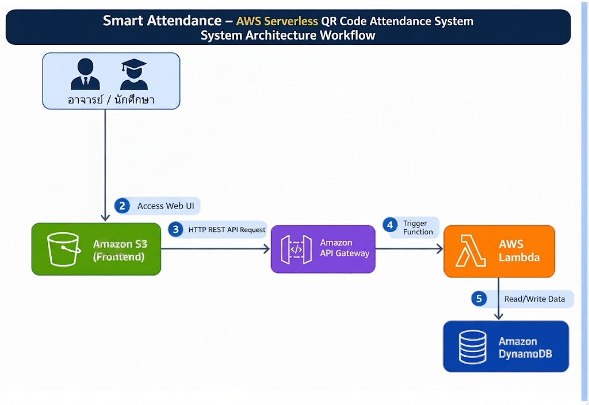
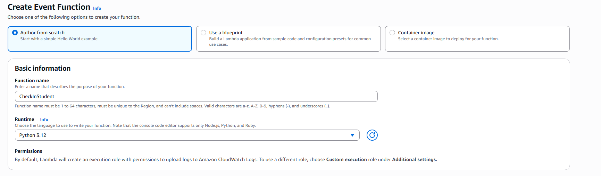
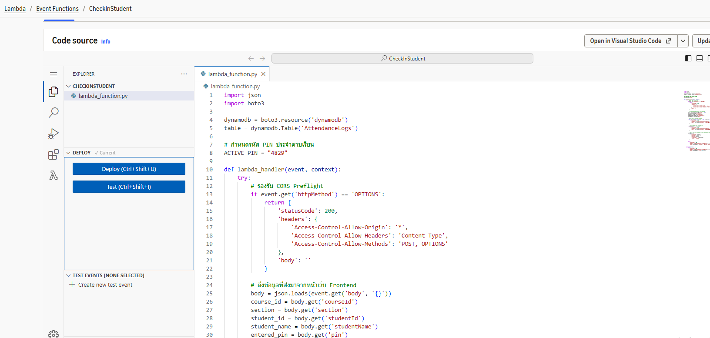
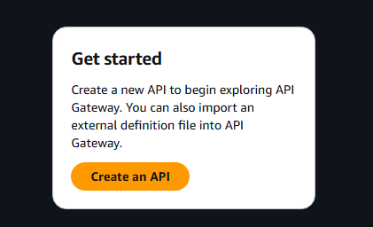
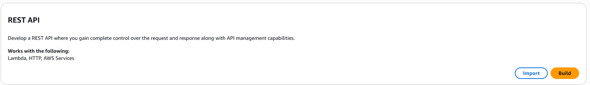
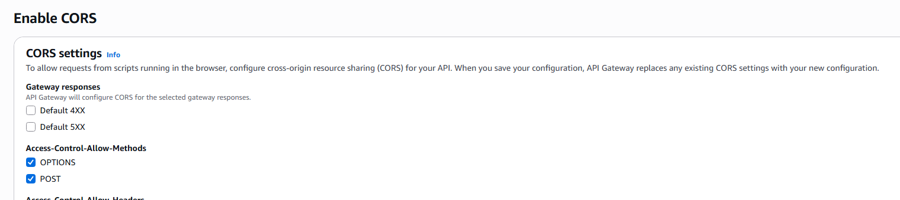
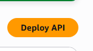
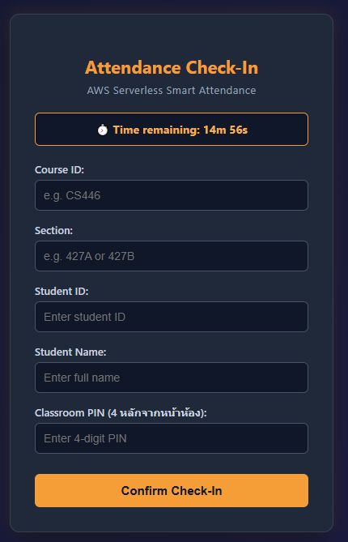
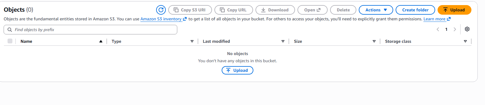
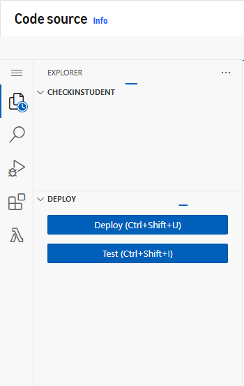

# AWS Serverless Smart Attendance

ระบบเช็กชื่อเข้าเรียนอัจฉริยะด้วยสถาปัตยกรรมแบบ Serverless บน AWS

## System Architecture

---

## Setup Guide (คู่มือการติดตั้งระบบ)

### Step 1: การสร้างฐานข้อมูล Amazon DynamoDB
1. เข้าสู่ **AWS Management Console** แล้วค้นหาบริการ **DynamoDB**[cite: 7]
2. คลิกปุ่ม **Create table** และกำหนดค่าดังนี้[cite: 7]:
   - **Table name:** `AttendanceLogs`[cite: 7]
   - **Partition key:** `StudentId` (เลือกประเภทเป็น String)[cite: 7]
   - **Sort key:** None (ไม่ต้องกำหนด)[cite: 7]
3. ปล่อยค่าอื่นๆ เป็นค่าเริ่มต้น แล้วคลิก **Create table**[cite: 7]

---

### Step 2: การสร้าง AWS Lambda Function (Backend)
1. ไปที่บริการ **AWS Lambda** > คลิก **Create function**[cite: 8]
2. 
3. เลือก **Author from scratch** และตั้งค่า[cite: 8]:
   - **Function name:** `CheckInStudent`[cite: 8]
   - **Runtime:** `Python 3.12`[cite: 8]
4. ในส่วน **Permissions**:
   - เลือก **Custom execution role** และค้นหาเลือก **LabRole** (เพื่อให้มีสิทธิ์เข้าถึงบริการอื่นตามโจทย์)[cite: 8]
     
   - คลิกปุ่มสีส้ม **Save** ที่มุมขวาล่าง[cite: 8]

5. นำโค้ด Python ไปวางทับในช่อง **Code source** ของ Lambda[cite: 8]
6. สามารถเข้าไปดูโค้ด Python สำหรับ Lambda ได้ที่ลิงก์นี้: 
[Lambda Function Code (lambda_function.py)](https://github.com/phakhawat12345/aws-serverless-smart-attendance/blob/main/lambda_function.py)
7. 
8. กดปุ่ม **Deploy** เพื่อบันทึกโค้ด[cite: 10]

---

### Step 3: การสร้าง API Endpoint ด้วย Amazon API Gateway
1. ไปที่บริการ **Amazon API Gateway** > เลือกสร้าง **REST API** (คลิก Build)[cite: 10, 11]

3.เลือก rest api 

4.. กำหนดค่า API[cite: 11]:
   - **Choose the protocol:** เลือก `REST API`[cite: 11]
   - **Create new API:** เลือก `New API`[cite: 11]
   - **API name:** `AttendanceAPI`[cite: 11]
   - **Endpoint Type:** เลือกเป็น `Regional`[cite: 11]

5.. เลื่อนลงมาด้านล่างแล้วคลิกปุ่ม **Create API**[cite: 11]

5. สร้าง Resource โดยคลิก **Create resource** ตั้งชื่อ Path ว่า `checkin`[cite: 12, 13]
6. 
7. เปิดใช้งานการเชื่อมต่อข้ามโดเมนโดยคลิกที่ทรัพยากร `/checkin` แล้วเลือก **Enable CORS**[cite: 12, 13]
   - ติ๊กถูกที่ช่องสี่เหลี่ยมหน้า **OPTIONS** และ **POST** ใต้หัวข้อ *Access-Control-Allow-Methods*[cite: 13]

8. แล้วคลิก **Create method** สำหรับรับข้อมูล:
   - เลือก Method type เป็น **POST**[cite: 12]
   - เลือก Integration type เป็น **Lambda Function**[cite: 13]
   - เปิดสวิตช์ **Lambda proxy integration** เป็น **ON**[cite: 13]
   - ช่อง Lambda Function ให้เลือก **CheckInStudent** แล้วกด **Create method**[cite: 13]

9. กดปุ่ม **Deploy API** ด้านบน เลือก Stage เป็น *New stage* และตั้งชื่อว่า `prod` แล้วกด **Deploy**[cite: 13]

10. คัดลอกค่า **Invoke URL** ที่ได้ (เช่น `https://xxxxxx.execute-api.us-east-1.amazonaws.com/prod/checkin`) เก็บไว้ใส่ในโค้ดหน้าเว็บ[cite: 14]

---

### Step 4: การเตรียมไฟล์หน้าเว็บ (Frontend) index.html
1.สร้างไฟล์ชื่อ index.html ขึ้นมาในคอมพิวเตอร์ของตัวเอง แล้วก๊อปปี้โค้ดสำเร็จรูปชุดนี้ไปใส่ข้างใน   
2.. สามารถเข้าไปดูโค้ด Python สำหรับ Lambda ได้ที่ลิงก์นี้:
3.. นำ URL ที่ได้จาก API Gateway ไปใส่ไว้ในตัวแปร `API_URL` ของไฟล์ `index.html`[cite: 14]

---

### Step 5: การโฮสต์เว็บขึ้น Amazon S3 และทดสอบระบบ
1. ไปที่บริการ **Amazon S3** > คลิก **Create bucket**[cite: 14]
   - ตั้งชื่อ Bucket เช่น `smart-attendance-frontend-[รหัสนักศึกษา]`[cite: 14]
   - **ยกเลิกการติ๊ก** ช่อง *Block all public access* ออก เพื่อให้คนอื่นเปิดดูเว็บได้[cite: 14]
   - คลิก **Create bucket**[cite: 14]

2. ตั้งค่า Static website hosting:
   - เข้าไปที่ Bucket ของคุณ > ไปที่แท็บ **Properties** เลื่อนลงมาล่างสุดที่หัวข้อ *Static website hosting* แล้วคลิก **Edit**[cite: 15]
   - เลือก **Enable**[cite: 15]
   - ช่อง *Index document* พิมพ์ `index.html` แล้วกด **Save changes**[cite: 15]

3. อัปโหลดไฟล์หน้าเว็บ:
   - ไปที่แท็บ **Objects** แล้วกด **Upload** นำไฟล์ `index.html` ที่แก้ไข API_URL เรียบร้อยแล้วอัปโหลดขึ้นไป[cite: 15]

4. ตั้งค่า Bucket Policy ให้เป็นสาธารณะ:
   - ไปที่แท็บ **Permissions** เลื่อนลงมาที่หัวข้อ *Bucket policy* แล้วคลิก **Edit**[cite: 16]
   - นำโค้ด JSON สิทธิ์การอ่านสาธารณะไปวาง (อย่าลืมเปลี่ยนชื่อ Bucket ให้ตรงของคุณ) แล้วกด **Save changes**[cite: 16]

5. เปิดใช้งานเว็บไซต์:
   - กลับมาที่แท็บ **Properties** เลื่อนลงมาที่ *Static website hosting* คัดลอกลิงก์ **Bucket website endpoint** ไปเปิดใช้งานในเบราว์เซอร์[cite: 16]

หน้าตาเว็บแอปพลิเคชันสำหรับเช็กชื่อจะแสดงผลพร้อมใช้งานทันที: **CLASSROOM PIN 4829 หรือ ตามที่ผู้ใช้งานตั้ง**

