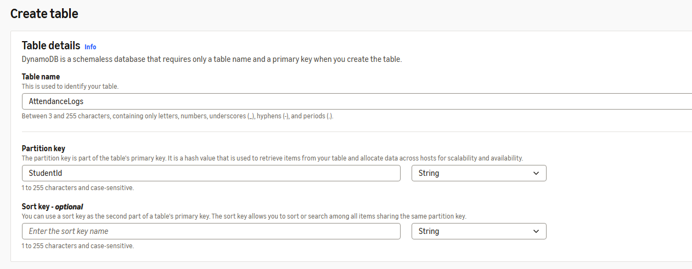
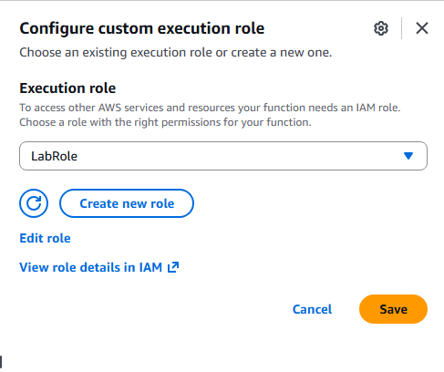
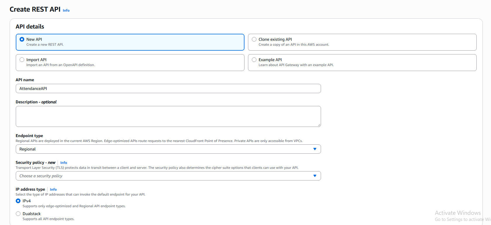
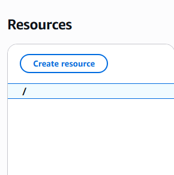
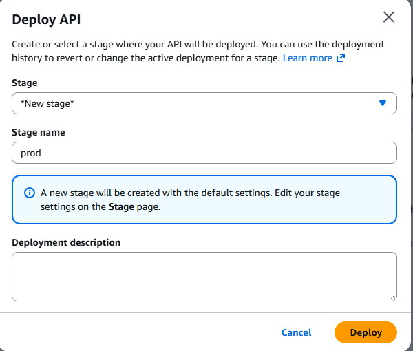
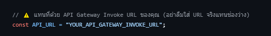
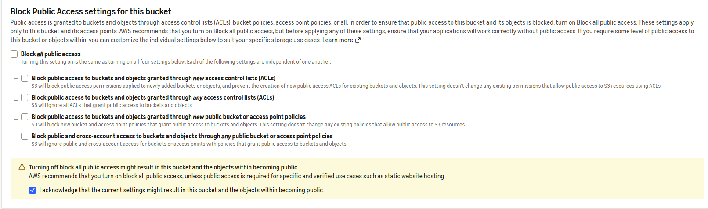
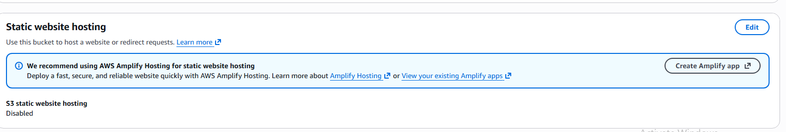
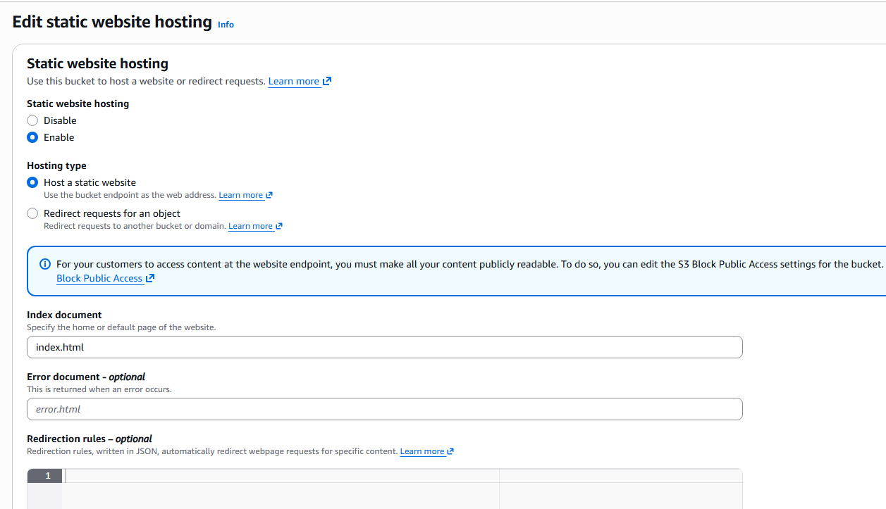
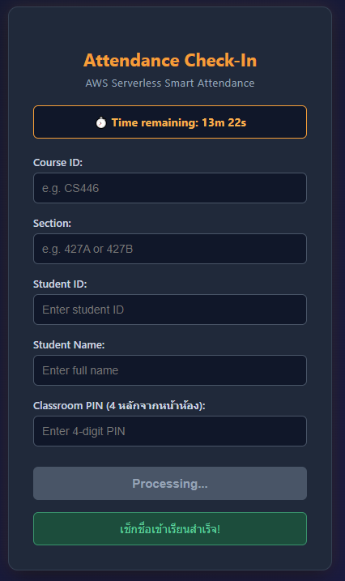

# ระบบจัดการการเข้าเรียนอัจฉริยะด้วย QR Code บนระบบคลาวด์ AWS
## 👥 Team Members (สมาชิกกลุ่ม)
* **ชื่อ นายพงศธร โชคณาโรจน์วงศ์        รหัสนักศึกษา 1660702810  - Section 427B
* **ชื่อ นายภัศพิณิศฐ์ธวัฒน์ บุตรสกุลไพจิตร  รหัสนักศึกษา 1660703933   - Section 427A
* **ชื่อ นายภควัต สุขสมโสตร             รหัสนักศึกษา 1660704279    - Section 427A
* **ชื่อ นางสาวละอองทิพย์ พ่อครวงค์       รหัสนักศึกษา 1660703016      - Section 427B
## 📌 ภาพรวมโปรเจกต์ (What is it?)
วิธีการเช็กชื่อแบบดั้งเดิม เช่น การขานชื่อหรือการใช้กระดาษเวียนเซ็นชื่อ มักประสบปัญหาการเสียเวลาเรียน ปัญหาการเช็กชื่อแทนกัน และความยุ่งยากในการรวบรวมข้อมูล
เพื่อแก้ปัญหาดังกล่าว พวกเราจึงพัฒนา AWS Serverless Smart Attendance ระบบเช็กชื่อเข้าเรียนอัจฉริยะผ่านเว็บแอปพลิเคชันบนโครงสร้างคลาวด์แบบ Serverless ระบบนี้เปิดให้นักศึกษากรอกรหัส PIN ประจำคาบเพื่อลงเวลาได้ทันที ช่วยขจัดขั้นตอนที่ซับซ้อน ป้องกันการทุจริตการเข้าเรียน และทำงานแบบอัตโนมัติได้อย่างรวดเร็ว

## 🛠️ บริการ AWS ที่ใช้งาน (AWS Services)
โครงสร้างสถาปัตยกรรมของโปรเจกต์นี้ใช้งานบริการหลักบน AWS ดังนี้:
1. **Amazon S3:** ใช้โฮสต์ไฟล์หน้าเว็บไซต์ Static Website Hosting (HTML/JS) เพื่อให้ผู้ใช้งานเข้าถึงหน้าเว็บผ่านอินเทอร์เน็ตได้
2. **Amazon API Gateway:** ใช้สร้าง REST API และจัดการเส้นทาง Routing (Endpoint `/checkin`) พร้อมเปิดใช้งาน CORS สำหรับรับ-ส่งข้อมูลจากหน้าเว็บ
3. **AWS Lambda (Python):** ทำหน้าที่เป็น Backend ประมวลผลคำขอเช็กชื่อโดยใช้ฟังก์ชัน Python (`CheckInStudent`) โดยไม่ต้องดูแลจัดการ Server เอง
4. **Amazon DynamoDB:** ใช้เป็นฐานข้อมูล NoSQL แบบรวดเร็ว (`AttendanceLogs`) โดยกำหนดให้ `StudentId` เป็น Partition Key สำหรับจัดเก็บประวัติการเช็กชื่อ

## System Architecture


## Setup Guide (คู่มือการติดตั้งระบบ)

### Step 1: การสร้างฐานข้อมูล Amazon DynamoDB
1. เข้าสู่ **AWS Management Console** แล้วค้นหาบริการ **DynamoDB**[cite: 7]
2. คลิกปุ่ม **Create table** และกำหนดค่าดังนี้[cite: 7]:
   - **Table name:** `AttendanceLogs`[cite: 7]
   - **Partition key:** `StudentId` (เลือกประเภทเป็น String)[cite: 7]
   - **Sort key:** None (ไม่ต้องกำหนด)[cite: 7]
3. ปล่อยค่าอื่นๆ เป็นค่าเริ่มต้น แล้วคลิก **Create table**[cite: 7]


---

### Step 2: การสร้าง AWS Lambda Function (Backend)
1. ไปที่บริการ **AWS Lambda** > คลิก **Create function**[cite: 8]
2. 
3. เลือก **Author from scratch** และตั้งค่า[cite: 8]:
   - **Function name:** `CheckInStudent`[cite: 8]
   - **Runtime:** `Python 3.12`[cite: 8]
   - วิธีหาและเลือก LabRole ให้ทำตามขั้นตอนนี้ได้เลยครับ:1. เปิดเมนู Additional settings:ให้มองหาหัวข้อคำว่า "Additional settings" แล้วคลิกเพื่อขยายเมนูลงมา
   - 2.เลือก Use an existing role:ในเมนูที่ขยายลงมา จะมีตัวเลือกให้เลือกประเภทของ Role ให้เลือกติ๊กที่ "Use an existing role" (การใช้ Role ที่มีอยู่แล้ว)
     3.ค้นหาและเลือก LabRole:จะมีช่องดรอปดาวน์ที่ชื่อว่า "Execution role" ปรากฏขึ้นมาให้คลิกที่ช่องนั้นแล้วพิมพ์ค้นหา หรือเลื่อนหาคำว่า LabRole (ซึ่งเป็น Role สำเร็จรูปของระบบแล็บ AWS) แล้วกดเลือกได้เลยครับ
4. ในส่วน **Permissions**:
   - เลือก **Custom execution role** และค้นหาเลือก **LabRole** [cite: 8]
     
   - คลิกปุ่มสีส้ม **Save** ที่มุมขวาล่าง[cite: 8]

5. นำโค้ด Python ไปวางทับในช่อง **Code source** ของ Lambda[cite: 8]
6. สามารถเข้าไปดูโค้ด Python สำหรับ Lambda ได้ที่ลิงก์นี้: 
[Lambda Function Code (lambda_function.py)](https://github.com/phakhawat12345/aws-serverless-smart-attendance/blob/main/lambda_function.py)
7. 
8. กดปุ่ม **Deploy** เพื่อบันทึกโค้ด[cite: 10]


---

### Step 3: การสร้าง API Endpoint ด้วย Amazon API Gateway
1. ไปที่บริการ **Amazon API Gateway** > เลือกสร้าง **REST API** (คลิก Build)[cite: 10, 11]

2.เลือก rest api 

3.. กำหนดค่า API[cite: 11]:
   - **Choose the protocol:** เลือก `REST API`[cite: 11]
   - **Create new API:** เลือก `New API`[cite: 11]
   - **API name:** `AttendanceAPI`[cite: 11]
   - **Endpoint Type:** เลือกเป็น `Regional`[cite: 11]

4.. เลื่อนลงมาด้านล่างแล้วคลิกปุ่ม **Create API**[cite: 11]

5. สร้าง Resource โดยคลิก **Create resource** ตั้งชื่อ Path ว่า `checkin`[cite: 12, 13]
6. 
7. แล้วคลิก **Create method** สำหรับรับข้อมูล:
   - เลือก Method type เป็น **POST**[cite: 12]
   - เลือก Integration type เป็น **Lambda Function**[cite: 13]
   - เปิดสวิตช์ **Lambda proxy integration** เป็น **ON**[cite: 13]
   - ช่อง Lambda Function ให้เลือก **CheckInStudent** แล้วกด **Create method**[cite: 13]

8. เปิดใช้งานการเชื่อมต่อข้ามโดเมน:
   - คลิกที่ทรัพยากร `/checkin`
   - เลือก **Enable CORS**
   - ติ๊กถูกที่ช่องสี่เหลี่ยมหน้า **OPTIONS** และ **POST** ใต้หัวข้อ *Access-Control-Allow-Methods*
     

9. กดปุ่ม **Deploy API** ด้านบน เลือก Stage เป็น *New stage* และตั้งชื่อว่า `prod` แล้วกด **Deploy**[cite: 13]


10. คัดลอกค่า **Invoke URL** ที่ได้ (เช่น `https://xxxxxx.execute-api.us-east-1.amazonaws.com/prod/checkin`) เก็บไว้ใส่ในโค้ดหน้าเว็บ[cite: 14]

---

### Step 4: การเตรียมไฟล์หน้าเว็บ (Frontend) index.html
1.สร้างไฟล์ชื่อ index.html ขึ้นมาในคอมพิวเตอร์ของตัวเอง แล้วก๊อปปี้โค้ดสำเร็จรูปชุดนี้ไปใส่ข้างใน   
2.. สามารถเข้าไปดูโค้ด index.html ได้ที่ลิงก์นี้:https://github.com/phakhawat12345/aws-serverless-smart-attendance/blob/main/index.html

3..นำ URL ที่ได้จาก API Gateway ไปใส่ไว้ในตัวแปร `API_URL` ของไฟล์ `index.html`[cite: 14]


---

### Step 5: การโฮสต์เว็บขึ้น Amazon S3 และทดสอบระบบ
1. ไปที่บริการ **Amazon S3** > คลิก **Create bucket**[cite: 14]
   - ตั้งชื่อ Bucket name เช่น `smart-attendance-frontend-[รหัสนักศึกษา]`[cite: 14]
   - **ยกเลิกการติ๊ก** ช่อง *Block all public access* ออกเพื่อให้คนอื่นเปิดดูเว็บได้[cite: 14]
   - **แต่ติ๊กถูก** ที่ช่อง **I acknowledge that the current settings might result in this bucket and the objects within becoming public** ที่อยู่ด้านล่างสุด เพื่อยืนยันการเปิดใช้งานสาธารณะ
   - 
   - คลิก **Create bucket**[cite: 14]

2. ตั้งค่า Static website hosting:
   - เข้าไปที่ Bucket ของคุณ > ไปที่แท็บ **Properties** เลื่อนลงมาล่างสุดที่หัวข้อ *Static website hosting* แล้วคลิก **Edit**[cite: 15]
   - 
   - เลือก **Enable**[cite: 15]
   - ช่อง *Index document* พิมพ์ `index.html` แล้วกด **Save changes**[cite: 15]
   -  - 


3. อัปโหลดไฟล์หน้าเว็บ:
   - ไปที่แท็บ **Objects** แล้วกด **Upload** นำไฟล์ `index.html` ที่แก้ไข API_URL เรียบร้อยแล้วอัปโหลดขึ้นไป[cite: 15]


4. ตั้งค่า Bucket Policy ให้เป็นสาธารณะ:
   - ไปที่แท็บ **Permissions** เลื่อนลงมาที่หัวข้อ *Bucket policy* แล้วคลิก **Edit**[cite: 16]
   - - นำโค้ด JSON สิทธิ์การอ่านสาธารณะไปวาง (อย่าลืมเปลี่ยน `YOUR-BUCKET-NAME` เป็นชื่อ S3 Bucket ของคุณ):
    
-
  ```json
  {
      "Version": "2012-10-17",
      "Statement": [
          {
              "Sid": "PublicReadGetObject",
              "Effect": "Allow",
              "Principal": "*",
              "Action": "s3:GetObject",
              "Resource": "arn:aws:s3:::YOUR-BUCKET-NAME/*"
          }
      ]
  }
-
  แล้วกด **Save changes**[cite: 16]

 5. เปิดใช้งานเว็บไซต์:
     กลับมาที่แท็บ **Properties** เลื่อนลงมาที่ *Static website hosting* คัดลอกลิงก์ **Bucket website endpoint** ไปเปิดใช้งานในเบราว์เซอร์[cite: 16]
 
 หน้าตาเว็บแอปพลิเคชันสำหรับเช็กชื่อจะแสดงผลพร้อมใช้งานทันที: **CLASSROOM PIN 4829 หรือ ตามที่ผู้ใช้งานตั้ง**
 
 QR Code สำหรับทดลองสแกนเช็คชื่อ


 ##ขั้นตอนการลบทรัพยากรบน AWS ตามลำดับ (แนะนำให้ลบย้อนหลังจากหน้าเว็บไปหลังบ้าน)
 
1.ลบ Amazon S3 Bucket (Frontend)
ไปที่บริการ Amazon S3
คลิกเลือก Bucket ของหน้าเว็บคุณ (เช่น smart-attendance-frontend-...)
สำคัญ: ก่อนลบ Bucket คุณต้องลบไฟล์ (Objects) ข้างในทั้งหมดก่อน โดยคลิกเข้าไป > เลือกไฟล์ทั้งหมด > กด Delete > พิมพ์คำว่า permanently delete เพื่อยืนยันการลบไฟล์
เมื่อ Bucket ว่างแล้ว ให้กลับมาที่หน้าหลักของ S3 เลือก Bucket นั้นอีกครั้ง แล้วกดปุ่ม Delete bucket > พิมพ์ชื่อ Bucket เพื่อยืนยันการลบ

2.ลบ Amazon API Gateway (Backend API)
ไปที่บริการ API Gateway
คลิกเลือก API ของคุณ (เช่น AttendanceAPI)
มองหาปุ่ม Actions ด้านบน หรือเมนูการตั้งค่า แล้วคลิก Delete API
พิมพ์ชื่อ API เพื่อยืนยันการลบทิ้ง

3.ลบ AWS Lambda Function
ไปที่บริการ AWS Lambda > คลิกเลือก Functions
เลือกฟังก์ชันของคุณ (เช่น CheckInStudent)
ที่มุมขวาบน ให้คลิกเมนู Actions > เลือก Delete
พิมพ์ชื่อฟังก์ชันเพื่อยืนยันการลบ

4. ลบตาราง Amazon DynamoDB
ไปที่บริการ Amazon DynamoDB > เมนูด้านซ้ายเลือก Tables
เลือกตารางของคุณ (AttendanceLogs)
คลิกปุ่ม Delete ด้านบน
ติ๊กยืนยันการลบ CloudWatch alarms (ถ้ามี) แล้วพิมพ์คำว่า delete เพื่อลบตารางฐานข้อมูลทิ้ง

